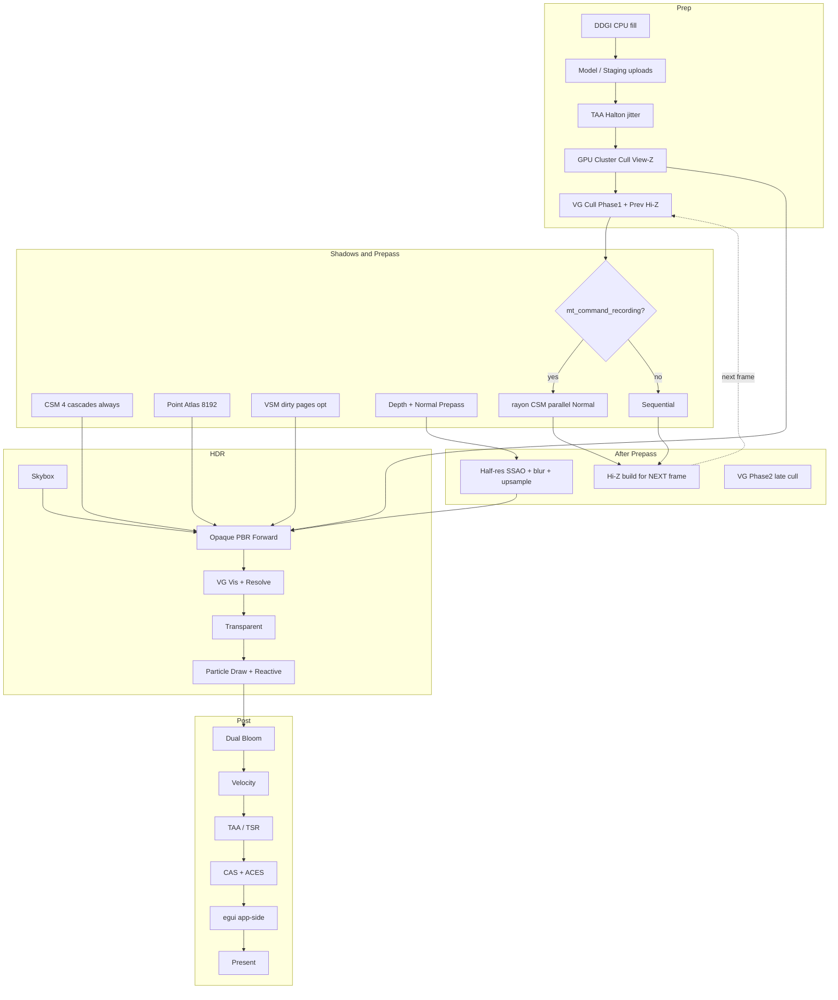

# RedOx Engine — Реальная архитектура (as-built)

> **Актуальность.** Каскадные карты теней (CSM) удалены из кода (коммит `9bcf961`): всё, что ниже
> написано про CSM/каскады, `ShadowUniform`, `csm.rs` и `shadow_probe`, описывает прошлое состояние.
> Прямой свет считается только через VSM. Остальные разделы сверены с кодом не полностью — см. `docs/ROADMAP_STAGE_0_1.md`, задача A6.


> **Статус:** Converging / Mostly Landed (не «полная production-конвергенция»)  
> **Дата среза:** 2026-08-25  
> **Источник истины:** `crates/redox_render/src/renderer/mod.rs` → `render_frame_into`  
> **Цель документа:** описать то, что **реально** есть в коде, с вставками и честными пробелами относительно target-архитектуры.

---

## 0. Вердикт одной строкой

Гибридный Forward+ / Visibility Buffer рендерер на **wgpu 0.20 + WGSL** с кластерным светом (View-Space Z), CSM/atlas тенями (единый 5×5 PCF в демо), optional VSM, SSAO, Bloom, TAA/TSR, CAS+ACES — **работает**.  
Не доведено до заявленного target: **DDGI probe RT**, **полноценный MT shadows**, **Stochastic A2C / vegetation extrusion**.

---

## 1. Слои crates (факт)

```
redox_core      App / winit / Time / Input / examples (prism_vault, …)
redox_ui        egui overlay (отдельный pass после 3D, LoadOp::Load)
redox_ecs       Archetype SoA + Rayon DAG
redox_physics   Rapier3D
redox_gameplay  Attributes / Abilities / StateTree
redox_audio     Kira + spatial
redox_scene     World Partition (OFPA / PCG)
redox_asset     Async loader + handles
redox_vfx       VFX helpers
redox_math      Math primitives
redox_input     Input abstractions
redox_render    GPU graphics core (этот документ в основном про него)
```

---

## 2. Реальный порядок кадра (`render_frame_into`)

Фактический timeline **не** совпадает 1:1 с «Phase 0–5» target-диаграммой. Ниже — то, что делает код.

```
[ Prep ]
  DDGI CPU update → model buffer → optional TAA jitter (Halton) → GPU cluster cull
  → VG Phase-1 cull (Hi-Z прошлого кадра) → CSM matrices / shadow uniform

[ Shadows + Prepass ]
  Optional rayon::join: CSM ‖ Normal/Depth prepass
  Atlas point shadows (main encoder) → VSM dirty pages
  (CSM depth всегда обновляется — даже при warm VSM)

[ After prepass ]
  Hi-Z build FROM current depth  →  используется на СЛЕДУЮЩЕМ кадре
  Half-res SSAO → bilateral blur → guided upsample
  (VG Phase 2 late cull: Hi-Z build → `record_gpu_cull_phase2`, в коде есть; визуально не проверено)

[ Main shading → HDR Rgba16Float ]
  Skybox (если IBL не dummy)
  Opaque Forward PBR (+ debug lines)
  VG vis buffer → fullscreen PBR resolve  (или debug forward)
  Transparent (depth read-only, back-to-front)
  Clear ReactiveMask → particle billboard draw (если alive > 0)

[ Post ]
  Bloom (dual-filter) → Velocity → TAA/TSR → CAS + ACES tonemap → surface

[ After renderer ]
  egui UI (app) → present
```

Ключевые якоря в коде:

```2303:2385:crates/redox_render/src/renderer/mod.rs
    pub fn render_frame_into(
        &mut self,
        objects: &[RenderObject],
        surface_view: &wgpu::TextureView,
    ) -> Result<(), wgpu::SurfaceError> {
        self.ddgi_gpu.update(/* … */);
        // …
        if self.cluster_manager.gpu_cull {
            self.cluster_manager.record_gpu_cull(&self.device, &mut encoder, &self.queue);
        }
        // VG GPU cull — Phase 1 only (previous-frame Hi-Z)
        if let Some(vg) = self.vg_system.as_mut() {
            if vg.config.gpu_cull && vg.active_instance_count() > 0 {
                vg.record_gpu_cull(
                    &self.device, &self.queue, &mut encoder,
                    &self.camera_uniform.view_proj, cam_pos, &self.hiz,
                );
            }
        }
```

```2868:2874:crates/redox_render/src/renderer/mod.rs
        // Build Hi-Z pyramid from depth prepass for next frame's occlusion culling.
        self.hiz.build_from_depth(
            &self.device,
            &self.queue,
            &mut encoder,
            &self.depth_view,
        );
```

```3375:3377:crates/redox_render/src/renderer/mod.rs
    /// Convenience wrapper: acquires a surface texture, renders into it, then
    /// presents it. Use `render_frame_into` + manual `present()` when you need
    /// to add additional passes (e.g. egui) before presentation.
```

---

## 3. Data transport — StagingRing

**Реально:** кольцевой CPU scratch + `queue.write_buffer`, `FRAMES_IN_FLIGHT = 2`, dynamic align ≥ 256.

```10:67:crates/redox_render/src/resource/staging_ring.rs
/// Number of virtual frames the ring keeps alive before reclaiming space.
pub const FRAMES_IN_FLIGHT: usize = 2;

/// Default ring capacity (64 MiB).
pub const DEFAULT_RING_CAPACITY: u64 = 64 * 1024 * 1024;
// …
    pub fn dynamic_align(&self) -> u64 {
        self.uniform_align.max(self.storage_align).max(256)
    }
```

---

## 4. Clustered lighting

### 4.1 Конфиг сетки

Не «фиксированные 16×16 тайлов экрана», а **тайл 16×16 пикселей** × **24 Z-среза**:

```
clusters_x = ceil(screen_w / 16)
clusters_y = ceil(screen_h / 16)
depth_slices = 24
```

При 1920×1080 ≈ `120 × 68 × 24` кластеров (не 16×16×24 = 6144).

```11:22:crates/redox_render/src/clustering.rs
pub mod cluster_config {
    pub const CLUSTER_SIZE_X: u32 = 16;
    pub const CLUSTER_SIZE_Y: u32 = 16;
    pub const CLUSTER_DEPTH: u32 = 24;
    pub const MAX_LIGHTS_PER_CLUSTER: u32 = 256;
    pub const MAX_LIGHTS: u32 = 512;
}
```

### 4.2 Метрика глубины — View-Space Z (planar)

Фрагмент и GPU-куллер используют **плоскостную** глубину (`-view.z` / `clip.w`), не евклидово `length(cam − pos)` (иначе круговая обрезка света на полу).

```1013:1016:crates/redox_render/shaders/pbr.wgsl
    // View-space Z (planar depth) — NOT euclidean distance (which draws circles on the floor).
    let view_pos = camera.view * vec4<f32>(in.world_pos, 1.0);
    let view_z = max(-view_pos.z, cluster_info.near);
    let cluster_z = get_depth_slice(view_z, cluster_info);
```

```66:92:crates/redox_render/shaders/cluster_cull_lights.wgsl
    // Perspective: clip.w == view-space depth along -Z (planar), not euclidean.
    let clip = cull_params.view_proj * vec4<f32>(light_pos, 1.0);
    let light_view_z = clip.w;
    // …
    let tile_x = cluster_idx % cluster_info.clusters_x;
    let tile_y = (cluster_idx / cluster_info.clusters_x) % cluster_info.clusters_y;
```

Куллер проверяет **конкретный тайл** кластера (не весь экран) и имеет clamp по `indices_capacity` (буфер индексов capped ~2M слотов).

Attenuation при `d = 0` безопасна: `1.0 / (dist*dist + 1.0)`.

---

## 5. Тени

### 5.1 Режимы directional (`soft_shadows` в GPU uniform)

| Значение | Путь |
|---|---|
| `0` | Жёсткий **5×5 PCF** CSM (`csm_sample`) |
| `1` | PCSS (переменный радиус, 16 Fibonacci + blue-noise dither) |
| `2` | VSM clipmap; при miss страницы — **fallthrough на CSM** |

В демо `prism_vault` выбран **вариант A — единый 5×5**:

```921:922:crates/redox_core/examples/prism_vault.rs
    sun.soft_shadows = false; // Unified clean 5×5 PCF (same look as point lights).
    sun.vsm = vsm; // F1 checkbox: VSM clipmap path when enabled.
```

```550:563:crates/redox_render/shaders/pbr.wgsl
fn csm_sample(cascade_idx: u32, uv: vec2<f32>, depth: f32) -> f32 {
    // 5×5 PCF — hides cascade texel stairs at distant umbrae.
    var visibility = 0.0;
    let texel_size = 1.0 / shadow_u.shadow_atlas_size;
    for (var y = -2; y <= 2; y = y + 1) {
        for (var x = -2; x <= 2; x = x + 1) {
            // …
            visibility += textureSampleCompareLevel(
                t_csm, s_csm, uv + offset, i32(cascade_idx), depth,
            );
        }
    }
    return visibility / 25.0;
}
```

```674:684:crates/redox_render/shaders/pbr.wgsl
    if (light_u.soft_shadows == 2u) {
        let lk = vsm_lookup(world_pos);
        if (lk.valid > 0.5) {
            return vsm_shadow(world_pos, normal, l_dir);
        }
        // fall through to CSM / PCSS below
    }
    var shadow: f32;
    if (light_u.soft_shadows == 1u) {
        shadow = pcss_csm(world_pos, view_z, normal, 0.016, dither);
```

CSM depth **всегда** рендерится (чтобы fallthrough VSM→CSM не семплил устаревшую глубину):

```2465:2468:crates/redox_render/src/renderer/mod.rs
        // Always refresh CSM depth when VSM is on: the shader falls through to
        // CSM outside resident clipmap pages. Skipping depth while matrices
        // still update every frame produces swimming / wrong OOB shadows.
        let render_csm_depth = true;
```

### 5.2 Point-light shadow atlas

- Атлас **8192²**, тайл **512**, сетка **16×16** → `MAX_CASTERS = 42` (по 6 граней).
- Пул `face_matrix_buffers`: `MAX_CASTERS × 6` — без race на общий буфер матриц.
- Семплинг: **5×5 PCF** (как CSM hard path).

```9:20:crates/redox_render/src/shadow/atlas_allocator.rs
pub const TILE_PX: u32 = 512;
pub const ATLAS_PX: u32 = 8192;
pub const TILES_PER_AXIS: u32 = ATLAS_PX / TILE_PX;
pub const TOTAL_TILES: u32 = TILES_PER_AXIS * TILES_PER_AXIS;
pub const MAX_CASTERS: u32 = TOTAL_TILES / 6; // 42
```

```1020:1023:crates/redox_render/src/renderer/mod.rs
        // One uniform + bind group per cube face per caster. Sharing 6 buffers
        // across casters races: Queue::write_buffer batches before the encoder,
        // so every face pass would sample the LAST caster's matrices.
        let face_slots = (MAX_CASTERS as usize) * 6;
```

```524:525:crates/redox_render/shaders/pbr.wgsl
    // 5×5 PCF — matches directional `csm_sample` look (monolithic, no grain).
    let texel_atlas = inv_tpa / 512.0; // TILE_PX = 512
```

### 5.3 SDF contact shadows

Есть cone-trace по brick-атласу; bias занижен (~`0.75 × texel`), чтобы уменьшить peter-panning. Ближний контакт миксуется с CSM.

### 5.4 MT command recording

При `mt_command_recording`: `rayon::join` параллелит **CSM ‖ Normal prepass**.  
Atlas point shadows и VSM остаются на main encoder — не полный параллельный shadow graph.

---

## 6. Virtual Geometry

| Возможность | Статус |
|---|---|
| Meshlets + meshopt simplify (`LockBorder`) | ✅ |
| GPU cull Phase 1 (frustum + cone + Hi-Z prev) | ✅ |
| Visibility buffer + fullscreen PBR resolve | ✅ |
| Sentinel clear `0xFFFF_FFFF` как `u32 as f64` (не NaN) | ✅ |
| **Phase 2 late cull после fresh depth** | ✅ в коде (`runtime.rs::record_gpu_cull_phase2`), требует визуальной проверки |

```5:5:crates/redox_render/shaders/vg_cull.wgsl
// Phase 1: frustum + backface cone + Hi-Z occlusion vs previous frame.
```

Phase 2 реализован: `cull_mode == 1` в `vg_cull.wgsl` повторно тестирует Hi-Z-отбраковку по свежей пирамиде.

Следствие: при резком повороте камеры возможен **1-frame occlusion lag / disocclusion pop**.

VG vis clear:

```3041:3046:crates/redox_render/src/renderer/mod.rs
                                        // R32Uint clear: do NOT use f32::from_bits(0xFFFF_FFFF)
                                        // (that is NaN; many drivers clear uint as 0). wgpu casts
                                        // Color.r as u32, and VIS_ID_SENTINEL as f64 is exact.
                                        load: wgpu::LoadOp::Clear(wgpu::Color {
                                            r: VIS_ID_SENTINEL as f64,
```

---

## 7. Bind groups (реальный PBR layout)

Документированный «идеальный» 4-group split **есть**, но binding indices богаче, чем в упрощённой схеме target-дока:

```7:14:crates/redox_render/src/pass/shared_layouts.rs
//! | Group | Role            | Bindings                                                        |
//! |-------|-----------------|----------------------------------------------------------------|
//! | **0** | Frame / global  | Camera, shader debug, IBL textures, BRDF LUT, blue noise       |
//! | **1** | Pass / scene    | Lights, shadows, clusters, VSM, DDGI, SDF atlas                |
//! | **2** | Materials       | Material uniform + albedo/normal/MR textures                   |
//! | **3** | Instances       | Model storage buffer                                           |
```

Факт из шейдера:

```48:121:crates/redox_render/shaders/pbr.wgsl
// ── Group 0: Frame / global (rare updates) ──────────────────────────────
@group(0) @binding(0) var<uniform> camera: Camera;
@group(0) @binding(1) var<uniform> shader_debug: ShaderDebugUniform;
@group(0) @binding(2) var t_irradiance: texture_cube<f32>;
// … BRDF LUT, blue noise …

// ── Group 1: Pass / scene (once per pass) ───────────────────────────────
@group(1) @binding(0) var<uniform> light_u: LightUniform;
// … SSAO, point_lights, clusters, CSM, atlas, VSM …
@group(1) @binding(16) var<uniform> ddgi_grid: DdgiGridGpu;
@group(1) @binding(17) var<storage, read> ddgi_probes: array<DdgiProbeGpu>;
@group(1) @binding(18) var<uniform> sdf_scene: SdfSceneGpu;
// …

// ── Group 2: Materials ──────────────────────────────────────────────────
@group(2) @binding(0) var<uniform> material: Material;
// …

// ── Group 3: Instances ──────────────────────────────────────────────────
@group(3) @binding(0) var<storage, read> models: array<Model>;
```

---

## 8. GI / IBL / DDGI

| Подсистема | Статус |
|---|---|
| IBL (irradiance + prefiltered + BRDF LUT) | ✅ |
| Skybox из env | ✅ (если не dummy IBL) |
| DDGI sampling в PBR (trilinear + octahedral) | ✅ CPU-filled probes |
| DDGI GPU ray-tracing / visibility | ❌ |

```1:5:crates/redox_render/src/gi/ddgi.rs
//! DDGI (Dynamic Diffuse Global Illumination) probe grid — CPU scaffold.
//!
//! Maintains a regular 3-D grid of irradiance probes updated each frame.
//! GPU ray-tracing is **not** implemented; see [`crate::gi::ddgi_gpu`] for the
//! honest GPU sampling path (trilinear + octahedral from CPU-filled probes).
```

```76:78:crates/redox_render/shaders/pbr.wgsl
// ── DDGI probe grid (Phase 5) ───────────────────────────────────────────
// Real: trilinear 8-probe blend + octahedral irradiance lookup.
// Missing: GPU ray-tracing / probe visibility (CPU fills samples).
```

---

## 9. Particles / ReactiveMask / TAA

```
ParticleGpuSystem::gpu_sim_enabled = true  (по умолчанию)
```

В кадре вызывается `record_gpu_sim` (если есть живые частицы) и **draw** билбордов с записью в ReactiveMask.

```306:307:crates/redox_render/src/pass/particles.rs
            gpu_sim_enabled: true,
            last_alive_count: 0,
```

TAA/TSR: velocity + YCoCg variance clip + motion boost + reactive blend + history×2.  
CAS включается вместе с TAA в tonemap uniform.  
Bloom: dual-filter 6-mip, soft threshold на luma ≥ 1.

---

## 10. Post & display

```
HDR (Rgba16Float)
  → Bloom composite
  → Velocity pass
  → TAA resolve (internal → full res при render_scale < 1)
  → Tonemap: optional 5-tap CAS + ACES → swapchain format
  → (app) egui LoadOp::Load
  → present
```

`render_scale` + Halton jitter дают TSR-путь при `taa_enabled && render_scale < 1`.

---

## 11. Матрица ресурсов (as-built)

| Ресурс | Формат | Производитель | Потребитель | Примечание |
|---|---|---|---|---|
| StagingRing | host scratch | CPU | GPU uploads | 64 MiB default, 256 align |
| HiZPyramid | R32Float mips | post-prepass | VG cull **next** frame | lag 1 кадр |
| LightGrid | storage | `cluster_cull_lights` / CPU | `pbr` / `vg_resolve` | View-Z |
| ShadowAtlas | Depth32 8192² | atlas pass | `pbr` | ≤42 casters |
| CSMArray | Depth32 ×4 | CSM pass | `pbr` | всегда refresh |
| VSM pages | 2D array | dirty pages | `pbr` soft=2 | optional |
| NormalDepth | Rgba16Float | normal prepass | SSAO | |
| SSAOBlurred | R16Float | upsample | `pbr` / resolve | half→full |
| ReactiveMask | R8Unorm | particles | `taa` | fallback 1×1 |
| VelocityTex | Rgba16Float | velocity | `taa` | internal res |
| HDRTarget | Rgba16Float | PBR/VG/FX | bloom/TAA | |
| TAAHistory | Rgba16Float×2 | taa | taa next | ping-pong |
| VG Vis ID | R32Uint | vg_vis | vg_resolve | sentinel `u32::MAX` |

---

## 12. Честный gap-лист (Target vs Reality)

| Target-claim | Reality | Приоритет |
|---|---|---|
| VG Phase 2 late cull same-frame | реализован в коде, нужна визуальная проверка | Low |
| GPU particle sim in Phase 1 | sim включён по умолчанию, draw в кадре | Low |
| Full MT: CSM+VSM+Atlas ‖ prepass | только CSM ‖ normal | Med |
| Fixed 16×16×24 clusters | `ceil(w/16)×ceil(h/16)×24` | Doc fix |
| DDGI with probe RT | CPU scaffold + sample | Feature |
| Stochastic A2C + vegetation extrusion | blue-noise alpha discard only | Feature |
| egui inside Phase 5 of renderer | app-side after `render_frame_into` | Doc fix |
| «Единый soft-shadow pipeline» | 0=PCF / 1=PCSS / 2=VSM; демо на PCF | OK for demo |

---

## 13. Инварианты, которые уже держатся

1. **Cluster Z = planar View-Z** — нет круговой обрезки точечного света на полу.  
2. **Point shadow matrices** — per-caster pool, без race `write_buffer`.  
3. **VIS_ID clear** — `VIS_ID_SENTINEL as f64`, не `f32::from_bits(NaN)`.  
4. **Unified hard shadows in demo** — sun + points на 5×5 PCF.  
5. **VSM OOB → CSM** корректен, потому что CSM depth всегда обновляется.  
6. **PBR bind groups 0..3** — wired; legacy «всё в group 0» устарело.

---

## 14. Mermaid — реальный dataflow



---

## 15. Как проверять руками (express)

1. `cargo run -p redox_core --example prism_vault --release`  
2. F1 → ShaderDebug: clusters / shadow sources.  
3. Тени кубов: sun и point должны быть визуально «одного семейства» (5×5).  
4. Точечный свет на полу — **без** идеальной окружности cutoff.  
5. Резкий 180° поворот — VG Phase 2 late cull должен убирать 1-frame pop (проверить визуально).  
6. Resize окна — TAA history + reactive пересобираются.

---

*Конец as-built документа. Target-архитектуру не путать с этим файлом: здесь только то, что подтверждено кодом на дату среза.*
