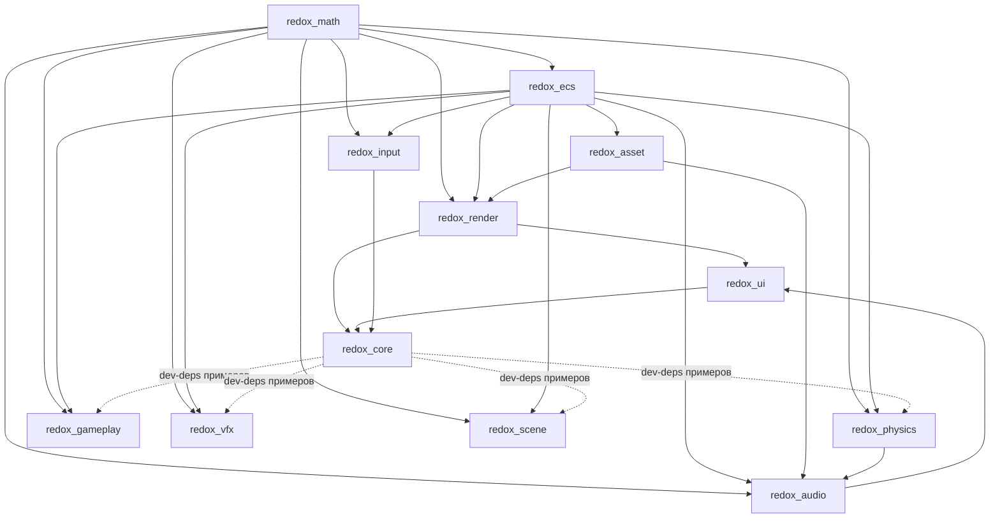

# RedOx Engine — Полная карта проекта

> По состоянию кода от 2026-08-25. Workspace `C:/Users/yann1n/RustroverProjects/redox_engine`.
> Документ описывает **каждый крейт**: назначение, файлы, ключевые типы, алгоритмы и техническую реализацию.

---

## Содержание

1. [Обзор движка](#1-обзор-движка)
2. [Граф зависимостей](#2-граф-зависимостей)
3. [`redox_math` — математика](#3-redox_math--математика)
4. [`redox_ecs` — archetype ECS](#4-redox_ecs--archetype-ecs)
5. [`redox_asset` — ассеты и hot reload](#5-redox_asset--ассеты-и-hot-reload)
6. [`redox_input` — ввод](#6-redox_input--ввод)
7. [`redox_physics` — физика (rapier3d)](#7-redox_physics--физика-rapier3d)
8. [`redox_render` — GPU-рендерер](#8-redox_render--gpu-рендерер)
9. [`redox_ui` — debug UI (egui)](#9-redox_ui--debug-ui-egui)
10. [`redox_audio` — звук (kira)](#10-redox_audio--звук-kira)
11. [`redox_gameplay` — геймплейные примитивы](#11-redox_gameplay--геймплейные-примитивы)
12. [`redox_vfx` — частицы](#12-redox_vfx--частицы)
13. [`redox_scene` — World Partition и PCG](#13-redox_scene--world-partition-и-pcg)
14. [`redox_core` — каркас приложения и примеры](#14-redox_core--каркас-приложения-и-примеры)
15. [Миры (`worlds/arena`)](#15-миры-worldsarena)
16. [Как собрать и запустить](#16-как-собрать-и-запустить)
17. [Известные недоделки и нюансы кода](#17-известные-недоделки-и-нюансы-кода)

---

## 1) Обзор движка

RedOx Engine — модульный data-oriented игровой движок на Rust в виде Cargo-workspace из **12 крейтов** (~31 000 строк Rust + 27 WGSL-шейдеров). Философия: явные односторонние зависимости между крейтами, предсказуемые пути выполнения («никакого FrameGraph — порядок пассов зашит в `Renderer::render_frame_into`»), современный GPU-рендеринг без тяжёлых абстракций.

| Слой | Крейты | Строк |
|---|---|---|
| Фундамент | `redox_math`, `redox_ecs` | ~3 200 |
| Ресурсы / IO | `redox_asset`, `redox_input` | ~2 300 |
| Симуляция | `redox_physics`, `redox_gameplay`, `redox_vfx`, `redox_scene`, `redox_audio` | ~4 000 |
| Графика | `redox_render` | ~16 300 |
| Обвязка / UI | `redox_ui`, `redox_core` | ~5 400 |

**Технологический стек** (корневой `Cargo.toml`):

- **GPU:** `wgpu 0.20` (Vulkan/DX12/Metal), шейдеры WGSL; окно — `winit 0.29`
- **Математика:** `glam 0.27`
- **Физика:** `rapier3d 0.18`; **звук:** `kira 0.8`; **UI:** `egui 0.28` (+egui-wgpu/winit/plot)
- **Параллелизм:** `rayon`, `crossbeam-queue`, `parking_lot`, `smallvec`, `hashbrown`, `flume`
- **Меши:** `meshopt` (кластеризация meshlet + quadric LOD), `tobj` (OBJ), `gltf 1.4`
- **Сериализация миров:** `serde` + `ron`; hot-reload — `notify`; изображения — `image 0.24`
- **Профили:** release = opt-level 3 + thin LTO + codegen-units 1 + panic=abort; dev = opt-level 1, но зависимости собраны с opt-level 3

Ключевые техники рендера: forward-пайплайн с кластерным освещением (16×16×24) и стохастической альтернативой ScatterLight (K=8), CSM + PCSS и VSM-clipmap тени, локальный атлас точечных теней 8192², TAA/TSR (Halton jitter, YCoCg clamp, variance clipping), SSAO, bloom (6-mip dual filter), ACES тонмаппинг, DDGI (CPU-fill проб + GPU-семплинг), SDF-конусные тени по 128³ атласу, Nanite-подобная Virtual Geometry на meshlet'ах (meshopt, LOD-цепочки, indirect draw, GPU compute-culling), World Partition со стримингом OFPA-ячеек.

---

## 2) Граф зависимостей

Односторонние path-зависимости между крейтами:



Правила из манифестов:
- `redox_math` (только glam) и `redox_ecs` — основание.
- `redox_render` зависит только от math/ecs/asset — не знает про физику, звук, геймплей.
- `redox_ui` — единственный потребитель одновременно render и audio (дебаг-панели).
- `redox_core` — композиционный корень: главный цикл; gameplay/vfx/scene подключены как dev-dependencies для примеров.
- Аномалия графа: `redox_audio → redox_physics` — аудио использует raycast'ы для окклюзии звука.

---

## 3) `redox_math` — математика

**Назначение:** тонкая типобезопасная обёртка над `glam 0.27` + несколько собственных примитивов, общих для всего движка. Единственная зависимость — glam.

**Файлы:** `vector.rs`, `matrix.rs`, `quat.rs`, `transform.rs`, `bounds.rs`, `frustum.rs`, `math.rs` (+ интеграционные тесты).

**Ключевые типы:**
- `Vec2/Vec3/Vec4`, `Mat3/Mat4`, `Quat` — прямые re-export glam-типов.
- Свободные функции: `transform_matrix(t, r, s)` (= `T*R*S` через `Mat4::from_scale_rotation_translation`), `look_at` (`look_at_rh`), `perspective` (`perspective_rh` — **depth range [0,1] под WebGPU**, не GL-вариант), `orthographic`.
- **`Transform`** — единый компонент трансформации движка: `translation: Vec3, rotation: Quat, scale: Vec3`; константа `IDENTITY`, конструкторы `from_translation*`, метод `matrix()`.
- **`Aabb { min, max }`**: `from_center_size` (аргумент — half-extents), `empty()` (+inf/−inf для expand-паттерна), `center/half_extents/size`; `transform(Mat4)` — **метод Арво** (центр × матрица + покомпонентный abs-dot экстентов: 3 mat-vec произведения вместо 8 трансформаций углов).
- **`Sphere { center, radius }`**, **`Plane { normal, distance }`** c `dot_point(p) = n·p + d`.
- **`Frustum { planes: [Plane; 6] }`** — извлечение плоскостей методом **Gribb-Hartmann** из view-proj в wgpu/DirectX clip space `[0,1]` (near = строка 3 напрямую); тесты `intersects_aabb` / `intersects_sphere` — консервативный **p-vertex**-метод (если «положительная вершина» бокса за плоскостью — весь бокс вне).

---

## 4) `redox_ecs` — archetype ECS

**Назначение:** собственный архетипный ECS — ядро движка. Сущности с generation-защитой, компоненты `'static + Send + Sync'`, SoA-хранение на сырых байтах с drop glue, tuple-запросы до 8 компонентов, фильтры `With/Without/Changed/Added` с tick-based change detection, rayon-параллельная **read-only** итерация, double-buffered события, типизированные ресурсы, данные иерархии.

**Зависимости:** hashbrown 0.14, parking_lot 0.12, crossbeam-queue, rayon, smallvec; dev-dep trybuild (compile-fail тесты).

**Структура:** `src/{ecs,component,entity,world,event,hierarchy}.rs`, `archetype/{mod,table,column}.rs`, `query/{mod,iter,filter,par_iter}.rs`, `tests/ecs_tests.rs` (~586 строк, 4 модуля), `tests/compile_fail/aliasing_iter_mut.rs`.

**Хранение (архетипы):**
- `Archetype { id, types: Vec<TypeId> /* отсортированный ключ */, table, component_infos }`, `unsafe impl Send/Sync`.
- `Table { columns: HashMap<TypeId, Column>, entities: Vec<Entity> }`; удаление строки — swap_remove с опциональным вызовом drop.
- `Column` — плотный байтовый буфер через `std::alloc`: начальная ёмкость 8, рост ×2; параллельные `ticks: Vec<u32>` и `added_ticks: Vec<u32>`; ручной Drop вызывает `drop_fn`.
- `ComponentInfo { type_id, size, align, drop_fn }`; `drop_fn = Some(drop_one::<T>)` при `needs_drop::<T>()`.
- Миграция архетипа при add/remove component: побайтовое копирование колонок → swap_remove старой строки **без деструкторов** (владение переехало); значения у вызывающего гасятся `std::mem::forget`. Отсутствие утечек доказано тестами со счётным аллокатором (`CountingAllocator`).
- Ключ поиска архетипа — отсортированный набор TypeId в `World::type_to_archetype`.

**Мир:** `World { entities: EntityAllocator, entity_locations, archetypes, resources: HashMap<TypeId, Box<dyn Any+Send+Sync>>, change_tick }`. API: `spawn/spawn_bundle/add_component/remove_component/despawn/get_component[_mut]/query/query_filtered`, ресурсы `insert/get/get_mut/remove_resource`, `begin_frame()`. `Bundle` реализован для кортежей 2..=8 (одиночный `(A,)` — нет). Нюанс: `spawn()` без компонентов не создаёт записи — сущность невидима до первого компонента.

**Сущности:** `Entity { id: u32, generation: u32 }`; `EntityAllocator` — parking_lot RwLock поколений + lock-free SegQueue свободных id + AtomicU32; повторное использование id повышает generation (stale handle отбрасывается).

**Запросы:** `unsafe trait QueryData { Item<'w>; matches(arch); fetch/fetch_mut; for_each_mutated }`, реализации `&T`, `&mut T`, `Entity`, кортежи 2..=8. Фильтры: `With<T>/Without<T>` — уровень архетипа; `Changed<T>/Added<T>` — построчные сравнения `tick > frame_tick`; кортежи фильтров 2..=6 (AND).
- `iter(&World)` доступен только для `ReadOnlyQueryData`; `QueryIterMut` хранит `*mut [Archetype]` от съеденного `&mut World` + `PhantomData<&'w mut …>`, что позволяет выдавать `&mut T` со временем жизни `'w`. Второй живой `iter_mut` невозможен — это зафиксировано **trybuild compile-fail тестом** (ожидается E0499; нюанс: файл ожидаемого stderr лежит в `wip/`, а не рядом с `.rs`, поэтому прогон требует переноса или `TRYBUILD=overwrite`).
- Любая мутабельная итерация штампует тики всех типов запроса (`for_each_mutated`) — change detection автоматический.

**Параллелизм:** `ParallelQuery::par_iter(&World)` (extension trait, нужен import) — rayon `ParallelIterator`; единица параллелизма — целый matching-архетип (`ArchChunk → flat_map_iter → ArchRowIter`), внутри чанка последовательный проход с построчными фильтрами. Строго `ReadOnlyQueryData`.

**События:** `Events<T> { events: Vec<(u64 id, T)>, cutoff }`; `update()` делает retain по cutoff ⇒ событие живёт **2 кадра**. `EventReader<T>` хранит только личный курсор — доставка ровно один раз, читатели независимы. Интеграция: `AppBuilder::add_events::<T>()` регистрирует hook `Events::update()` в конце кадра.

**Иерархия:** только данные — `Parent(pub Entity)`, `Children(SmallVec<[Entity;8]>)`; API репарентинга/обходов нет (заготовка).

---

## 5) `redox_asset` — ассеты и hot reload

**Назначение:** MVP-система ассетов: типизированные handle'ы, per-type хранилища, фоновая загрузка в отдельном потоке, события загрузки в ECS, hot-reload через файловый вотчер.

**Файлы:** `handle.rs`, `storage.rs`, `manager.rs`, `hot_reload.rs`, `event.rs`, `error.rs`, `loader/{mod,gltf_loader,image_loader}.rs`.

**Handle'ы:** `AssetId(u64)` — глобальный атомарный счётчик; `AssetStatus::{Loading, Ready, Failed}`; `Handle<T>` — Copy-структура `{ id, PhantomData<T> }` (ручные Clone/Copy/Eq/Hash, чтобы не требовать их от T); `WeakHandle` — семантический (рефкаунтинга нет, ведут себя одинаково).

**Хранилище:** `AssetStorage<T> { assets: HashMap<AssetId,T>, statuses }` — insert/mark_loading/mark_failed/get/status/remove.

**Менеджер (`AssetManager`, ECS-resource):**
- Поля: `base_path`, `storages: HashMap<TypeId, Box<dyn Any>>`, типостёртые `inserters`/`failed_markers` (fn-указатели), `path_to_handle: HashMap<PathBuf,(TypeId, AssetId)>` (кэш + база hot-reload), реестр лоадеров `Arc<RwLock<HashMap<TypeId, LoaderErased>>>`, каналы flume, опциональный `HotReloadWatcher`.
- **Фоновый поток:** один воркер (`worker_loop`) читает `LoadTask { type_id, id, path, is_reload }` из flume, читает файл, зовёт лоадер типа, шлёт назад `LoadComplete`. `load_async::<T>(path)` возвращает handle немедленно (status Loading), кэшируется по пути. `load_async_with(closure)` — one-off загрузка в собственном потоке без кэша.
- `update(world)` каждый кадр: дренирует запросы hot-reload (reload по тому же AssetId), забирает завершения, вставляет в storage, шлёт ECS-события `AssetLoadedEvent` / `AssetReloadedEvent` / `AssetLoadFailedEvent` через `Events<T>` ресурсы мира.
- Встроенные лоадеры: `ImageLoader` (→ `image::DynamicImage`) и `GltfLoader` (→ `GltfSceneData`); переопределяются `register_loader`.

**Hot reload:** обёртка над `notify::RecommendedWatcher`; канал mpsc; `drain_reload_requests()` отдаёт пути событий `EventKind::Modify`; watcher рекурсивный (`RecursiveMode::Recursive`).

**glTF-лоадер:** грузит самодостаточные `.glb` / `.gltf` с `data:` URI (внешние ссылки → ошибка). Продукт — serde-сериализуемый `GltfSceneData { meshes, materials, nodes, textures }`: один `GltfMeshData` на примитив (суффикс `.p{i}`), TRS нод сохраняются как есть, текстуры декодируются в RGBA8 (поддержка 8/16-бит unorm, f32), матричная авторизация раскладывается в TRS (кватернион методом Шепарда). Тангенты: авторский `TANGENT` выигрывает, иначе генерация методом Ленгела — **локальная копия** алгоритма (asset не может зависеть от render; обе копии покрыты тестами).

---

## 6) `redox_input` — ввод

**Назначение:** агрегированное состояние ввода как ECS-ресурс + слой абстрактных действий (action mapping).

**Файлы:** `lib.rs`, `state.rs`, `action.rs`, `keyboard.rs`, `mouse.rs` (~530 строк, с юнит-тестами).

**Типы:**
- `InputState { keyboard, mouse, actions }` — главный ресурс; `begin_frame()` в начале кадра (переносит current→previous), `process_window_event(&winit::WindowEvent)` прокидывает KeyboardInput/CursorMoved/MouseInput/MouseWheel (LineDelta и PixelDelta).
- `KeyboardState` — HashSet зажатых `KeyCode` + previous-набор: `is_pressed / just_pressed / just_released`.
- `MouseState` — позиция в логических пикселях, delta, scroll_delta, наборы кнопок current/previous; те же три запроса для `MouseButton { Left, Right, Middle, Other(u16) }`.
- **Action mapping:** `ActionKind::{Digital(bool), Analog(f32)}`; `ActionBinding::{Key(KeyCode), Axis{positive,negative}, Mouse(MouseButton)}`; `ActionMap` — `HashMap<String, Vec<ActionBinding>>` с `add/evaluate`; `InputState::action(name)` → ActionKind, convenience `action_active()` (Analog активен при |v|>0.5) и `action_value()`.

---

## 7) `redox_physics` — физика (rapier3d)

**Назначение:** интеграция rapier3d 0.18 с ECS: владение миром Rapier в ресурсе, двусторонняя синхронизация Transform↔Rapier, рейкасты (включая рейкасты с исключением сущностей — используется аудио-окклюзией).

**Файлы:** `context.rs` (~330 строк), `sync.rs`, `components.rs`, `raycast.rs`, `utils.rs`, `physics.rs` (реэкспорты), `lib.rs`.

**PhysicsContext (ECS-resource):** владеет всеми наборами Rapier (`RigidBodySet`, `ColliderSet`, `PhysicsPipeline`, `BroadPhase/NarrowPhase`, `CCDSolver`, `QueryPipeline`, `IntegrationParameters`, gravity) + маппинги `entity_to_body: HashMap<Entity,(RigidBodyHandle, Vec<ColliderHandle>)>` и обратный `collider_to_entity` (для атрибуции попаданий рейкастов) + lock-free очередь raycast-запросов.
- `step(dt)` — выставляет dt и делает `physics_pipeline.step(..., Some(&mut query_pipeline))` (BVH обновляется за шагом).
- `add_rigid_body(entity, RigidBodyBuilder, Vec<ColliderBuilder>)`, `remove_rigid_body` (каскадное снятие коллайдеров), `set_rigid_body_transform/velocity`, `active_bodies()`.
- `cast_ray_excluding(origin, target, exclude_entities)` — направление/дистанция из отрезка, исключённые ColliderHandle собираются из маппинга, фильтр `predicate(|h,_| !excluded.contains(h))`; возвращает `(toi, Entity)` или None (линия видимости свободна).

**Компоненты:** `RigidBody { handle }`, `Collider { handle }`, `Velocity { linvel, angvel }`, маркер `Kinematic`.

**Политика синхронизации** (`sync.rs`, цепочка вешается AppBuilder'ом на Stage::PhysicsSync):
1. `sync_to_physics`: тела с маркером `Kinematic` получают `Transform` (управляются кодом), остальные — `Velocity` → linvel/angvel.
2. `step_physics(world, dt)`.
3. `sync_from_physics`: **не**-Kinematic тела перезаписывают `Transform` из симуляции.
Паттерн обхода borrow checker (общий для движка): `world.remove_resource::<PhysicsContext>()` → работа → возврат ресурса.

**Рейкасты:** события `RaycastRequest/RaycastResult` + система-прокладка. Честно помечено в коде: отправка результатов обратно в Events **не доделана**, нормаль попадания захардкожена — реально работает прямой `cast_ray_excluding`.

---

## 8) `redox_render` — GPU-рендерер

Единственный графический крейт (~16 300 строк Rust + 27 WGSL): wgpu-рендерер с forward-шейдингом, фиксированным конвейером проходов (FrameGraph нет; `FrameView` — просто входной бандл кадра), кластерным освещением, CSM/VSM-тенями, TAA/TSR, IBL, Virtual Geometry, DDGI/SDF-хуками и пост-обработкой. Композиционный корень — `renderer/mod.rs` (**3360 строк**).

### 8.1 Ядро

**Файлы верхнего уровня:** `frame.rs`, `renderer/mod.rs`, `context.rs`, `registry.rs`, `asset_types.rs`, `material.rs`, `light.rs`, `camera.rs`, `clustering.rs`, `cluster_manager.rs`, `systems.rs`, `shader/mod.rs`, `resource/{buffer,texture,ibl}.rs`, `mesh/{loader,tangent,primitive}.rs`.

- **`Renderer::new(window, present_mode)`**: Instance на всех backend'ах → surface → адаптер HighPerformance → устройство с единственной фичей `SHADER_PRIMITIVE_INDEX`; sRGB surface format, frame latency 2. Внутреннее разрешение = output × `render_scale` (clamp 0.5..2.0; <1.0 = TSR-режим, `uses_tsr() = taa_enabled && render_scale < 0.999`). Создаются HDR Rgba16Float, depth Depth32Float, normal Rgba16Float, SSAO R16Float, bloom mip-chain (6), CSM-массив 4×2048², локальный теневой атлас **8192²**, model-storage на 10 000 объектов.
- **`FrameView<'a> { camera, objects: &[RenderObject], lights: &LightScene, environment: Option<&IBLResource> }`** — предпочтительный вход `render_frame_view`.
- **`RenderContext(Renderer)`** — Deref-фасад обратной совместимости для примеров.
- **`GpuRegistry`**: `Pool<T> { slots: Vec<Option<T>>, free: Vec<usize> }` — O(1) рециклинг слотов; пулы мешей/материалов/текстур + `HashMap<AssetId, usize>`. Параллельно живут легаси append-only массивы материалов/текстур — конвейер пока читает именно их (помечено «removed when callers migrate to handles»).
- **Материалы:** `MaterialData` (ассет-дескриптор: base/metallic/roughness/emissive, `Option<Handle<TextureData>>` слоты albedo/normal/mr, `BlendMode`, sheen, до двух `MaterialLayer { base_color, metallic, roughness, weight }` — Substrate-стиль). GPU-layout `MaterialUniform` — ровно **112 байт** (compile-time assert), флаги `HAS_ALBEDO_TEX/HAS_NORMAL_TEX/HAS_MR_TEX/HAS_SUBSTRATE`.
- **Свет:** `DirectionalLight` (source_angle 0.0087 рад ≈ полутень для SMRT/PCSS, soft_shadows, vsm), `PointLight { position, color, intensity, radius, cast_shadows, source_radius }`, `SpotLight`; сцена `LightScene { directional, ambient, points, spots }`. Legacy-юниформ несёт фикс. массив 128 point lights; кластерный путь — STORAGE `PointLightGpu` (128 Б): позиция, цвет, **6 матриц кубических граней внутри лайта**, intensity/radius, `shadow_tile_base` (`NO_TILE=0xFFFFFFFF`).
- **Камера:** `CameraUniform` — раздельные view/proj/inv_view/inv_proj/**prev_view_proj** (448–464 Б); `apply_jitter_ndc` сдвигает `proj.z_axis.x/y`; Halton(2)/Halton(3) джиттер ±0.5 px внутреннего разрешения (см. 8.3).
- **Кластерный свет — чисто CPU:** сетка тайлов 16×16 px × **24 логарифмических глубинных слайса** (`z_i = near·(far/near)^(i/(N−1))`, `depth_scale = ln(far/near)/(N−1)`), капы `MAX_LIGHTS=512`, `MAX_LIGHTS_PER_CLUSTER=256`. Назначение — консервативный двухэтапный тест сферы света против кластера: перекрытие лог-диапазона глубины + screen-space NDC-футпринт, расширяемый проекцией радиуса (при `w≤0` свет сохраняется). Результат: плоский `light_indices` + `cluster_metadata {offset,count}`. `ClusterManager` держит 5 GPU-буферов, растёт только при увеличении сетки, отдаёт статистику для дебаг-UI; жёсткий кап индексного буфера 2M элементов.
- **Шейдеры:** все 27 `.wgsl` лежат в `crates/redox_render/shaders/` и **вкомпилированы `include_str!`** — дефолтная сборка не трогает ФС. Под feature `shader-hot-reload` `load(name)` читает файл с диска с fallback на embedded; watcher пересоздания пайплайнов помечен как нереализованный. `create_shader_module` — единственная точка создания модулей.
- **Текстуры:** `upload_2d` с учётом align-256 стейджинга; mip-цепочка генерируется **blit render-pass'ами** (fullscreen-triangle, UV из vertex_index; пайплайны кешируются в глобальном `LazyLock<HashMap<TextureFormat, Arc<RenderPipeline>>>`); HDR-загрузка Radiance → f16 RGBA → Rgba16Float; фабрики 1×1 fallback (white/normal/mr).
- **IBL:** `IBLProcessor` — 4 compute-пайплайна: equirect→cube (1024², 6 слоёв через storage-view), irradiance cube 32px, prefiltered 128px×5 mip (roughness = mip/(mips−1)), BRDF LUT 512². Каждый entry-point в отдельном WGSL-модуле (naga не терпит два типа на одном binding разных пайплайнов). `IBLResource::dummy()` — чёрные заглушки, skybox пропускается.
- **Меши:** `Vertex` 44 Б (pos/normal/uv/tangent.xyz; handedness w в layout не входит — помечено), OBJ через tobj (triangulate+single_index), тангенты — канонический метод Ленгела (Грам–Шмидт, `w=±1`, fallback [1,0,0]); примитивы cube/sphere/torus/quad (+cube с инвертированными нормалями для интерьеров) с юнит-тестами.
- **ECS-интеграция (`systems.rs`)**: компоненты `MeshHandle/MaterialHandle/PreviousTransform`; `extract_render_objects` собирает `RenderObject { model_matrix, color, mesh_index, material_index, bounds }` по наличию Transform+Mesh+Material и загруженности ассетов; world-AABB — Арво-трансформация; `sync_assets_to_render` идемпотентно заливает меши→текстуры→материалы.

### 8.2 Конвейер кадра (`render_frame_into`)

Фактический порядок (один encoder → один submit):

1. CPU-подготовка: CPU-fill DDGI-проб; запись ModelUniform в model-storage; фрустум-куллинг главного вида (индексы инстансов остаются глобальными); TAA-джиттер (unjittered VP сохраняется, в GPU уходит джиттерованный); опционально GPU-cull VG.
2. **CSM**: `CsmState::update(view, proj, light_dir, 2048, near, far)` от **реальных** матриц камеры; до 4 shadow-pass по слоям массива; эвристика пропуска плоских «слэбов»; в каскады дополнительно рисуется VG indirect.
3. **Локальные точечные тени**: кастеры сортируются по dist² до камеры; `ShadowAtlasAllocator` выделяет run из 6 плиток 512² в атласе 8192² (16×16 = 256 плиток ≈ 42 кастера; переполнение → свет рисуется без тени); один render pass на caster, viewport/scissor на плитку; после — патчинг `PointLightGpu` матрицами граней и перезапись cluster-буфера.
4. **VSM (опция)**: clipmap-update, запрос страниц только покрывающих AABB сцены; таблицы страниц пишутся после аллокации; каждая грязная страница — отдельный pass с dynamic-offset uniform (stride 256 Б); Clear(WHITE)=«нет окклюдера».
5. **Normal pre-pass** → world-normal + линейная глубина (Rgba16Float), общий depth.
6. **SSAO** → R16Float + blur; выключенный SSAO = явный Clear белым.
7. **Forward HDR** (Clear (0.05,0.05,0.08)): skybox первым при чистом depth (если IBL не dummy) → opaque PBR (BG0 global / BG1 материал / BG2 model-storage) → debug lines.
8. **VG visibility-path** (см. 8.7) либо debug forward teal-путь.
9. **Transparent** (только если есть alpha-материалы): depth read-only, сортировка back-to-front по dist² центров AABB.
10. **HDR post-FX**: ScatterLight (если режим включён) → bloom dual-filter (downsample mip0 с threshold → 5 даунсемплов → аддитивный tent upsample → composite → copy scratch→HDR).
11. **Velocity** (из depth: inv текущей джиттерованной VP + прошлая unjittered) → **TAA resolve** ping-pong → **тонмаппинг** уже из свежего history-слота на swapchain; свап истории, prev_vp ← unjittered, frame++ (первый кадр — reset без джиттера). Без TAA — тонмап прямо из HDR.

`resize` пересоздаёт всё размерозависимое (internal vs output: TAA-history на **output**-разрешении, velocity/VG на internal), сбрасывает `taa_frame_count`, пересобирает кеш bind groups.

### 8.3 Пассы и пост-обработка (`pass/*`, `post/*`)

Каждый файл экспортирует один Pass-тип (pipeline + BGL). Все фуллскрин-эффекты рисуются одним fullscreen-треугольником `draw(0..3,0..1)`; compute в этих слоях нет (единственный compute — VG GPU-cull).

- **`shared_layouts.rs`**: общие BGL (camera/light/model/texture), `DEPTH_FORMAT=Depth32Float`, `ModelUniform` 128 Б (mat4 + vec4-strided normal matrix + color), `create_depth_texture` (RENDER_ATTACHMENT|TEXTURE_BINDING — depth читают velocity/VG/ScatterLight). `forward.rs` — legacy-алиасы.
- **`PbrPass`** — главный opaque-пайплайн. Vertex layout = mesh::Vertex; instance_index индексирует storage моделей; нормаль через inverse-transpose на CPU, реортогонализация тангента. **group(0) — 29 биндингов**: камера (b0), LightUniform (b1), legacy shadow depth (b2–3), irradiance/prefiltered cubes + BRDF LUT (b4–6), SSAO tex+sampler non-filterable (b7–8), IBL sampler (9), `array<PointLightGpu>` (10), cluster metadata/indices/info (11–13), CSM array + comparison sampler (14–15), локальный атлас (16), ShadowUniform 288 Б (17), ShaderDebug (18), VSM pages + info (19–21), DDGI grid/probes (22–23), SDF scene uniform + 3D texture + sampler (26–28). **group(1)** — материал (112 Б юниформ + albedo/normal/mr + sampler). FS: Cook-Torrance, metallic*=mr.b, roughness clamp 0.05..1, геометрическая нормаль из ddx/ddy; directional × CSM (выбор каскада по view_z vs splits, slope-scaled bias, PCF 5×5 либо PCSS variable radius) × SDF cone trace; point lights — кластерный цикл (attenuation `1/(d²+1)·smoothstep-window`, кубическая тень выбором грани + тайл атласа); ambient = IBL (prefilter mip = roughness·4) + два substrate-слоя; AO умножается; DDGI trilinear 8-probe blend; debug-overlay режимы (кластеры / значение тени / источники цветами).
- **`ScatterLightPass`** — стохастическая альтернатива clustered forward: пиксель аккумулирует ровно K=8 случайных светов; RNG — integer-hash xorshift, seed включает frame_index (интеграция через TAA). Позиция реконструируется из depth через `inv_view_proj`, нормаль — из соседних пикселей глубины; shadow rays / reservoir sampling — follow-up.
- **`ShadowPass`** — depth-only (fragment нет), cull_mode None (dual-face ради тонких кастеров), bias 0 (комментарий: большой constant/slope на Depth32Float «съедал» тени), SHADOW_SIZE=2048.
- **`NormalPass`** → Rgba16Float (rgb=world normal, a=linear depth, FAR=1000).
- **`SkyboxPass`** — cubemap fullscreen-треугольником, z=w=1.0 (far plane), depth LessEqual+write, рисуется первым.
- **`TransparentPass`** — тот же pbr.wgsl с ALPHA_BLENDING и depth write off.
- **`DebugLinesPass`** — LineList, MAX_LINES=512, верш. 28 Б; occluded=true → жёлтый, false → циан; потребитель — аудио-дебаг.
- **`VelocityPass`** — Rgba16Float (xy=UV-дельта); небо (depth≥0.9999) → ноль; реконструкция мира через inv джиттерованной VP, предыдущий UV через prev unjittered.
- **`TaaPass`** — ping-pong две истории Rgba16Float. Алгоритм: 4×4 separable Catmull-Rom ресемплинг current (резкость при апскейле); AABB окрестности 3×3 в **YCoCg**; variance clipping по люме (k=1.5); reproject `uv − velocity.xy` (out-of-screen/reset → alpha=1); история тоже Catmull-Rom с клампингом; motion boost `alpha += clamp(|vel|px/24,0,1)×0.20`; `mix(history, current, alpha)`. CPU: Halton bases 2/3; `blend_alpha` default 0.05, clamp 0.02..0.20.
- **`SSAOPass`** (устарело: сейчас шейдеры GTAO — `gtao*.wgsl`, SSAO-алиасы удалены; описание ниже относится к прежнему SSAO): 64 сэмпла полусферы (CPU rand, масштаб lerp(0.1,1,(i/N)²)), noise 4×4 Rgba32Float Repeat/Nearest; экранное сравнение глубин с bias 0.025 (помечено как MVP, не view-space); выход `1−occ/64` → R16Float; blur — простой box 4×4 (**не bilateral**, вопреки README).
- **`BloomPass`**: 6 отдельных Rgba16Float mip'ов; downsample box5 (вес 0.2), mip0 — с soft-knee threshold по Rec.709 люме; upsample 9-tap tent (веса 4,2…1)/16 ×1.15 с ADD-blend прямо в более мелкий mip (классический Calloway dual-filter); composite `base + bloom×0.4` → scratch → копия в HDR.
- **`tone_mapping.rs`**: exposure → **ACES filmic (Narkowicz 2015)** `(x(2.51x+0.03))/(x(2.43x+0.59)+0.14)`; гамма не применяется — её кодирует sRGB surface format. Опциональный contrast-adaptive sharpen (5-tap крест, адаптация по luma-range, clamp против ringing) существует, но renderer всегда пишет `sharpen_enabled: 0`.

### 8.4 Шейдеры (`shaders/*.wgsl`)

27 файлов, инлайнятся include_str! в `shader/mod.rs` (`FORWARD_WGSL`, `PBR_WGSL`, `TAA_WGSL`, `VSM_DEPTH/VISIBILITY/SMRT_WGSL`, `VG*_WGSL` — 5 шт., `SCATTER_LIGHT_WGSL`, `SDF_SHADOW_WGSL`, IBL-четвёрка + `BRDF_LUT_WGSL` и др.). Соответствие пассам: pbr↔pbr.wgsl, vg_resolve↔vg_vis/vg_resolve/vg_shadow.wgsl, gpu_cull↔vg_cull.wgsl, vsm_clipmap↔vsm_*.wgsl, ssao↔ssao(+blur), bloom↔bloom(+composite) и т.д.

### 8.5 Тени (`shadow/*`)

- **CSM (`csm.rs`)**: 4 каскада, `ShadowUniform` (4 матрицы + splits + soft_near/far для PCSS-линеаризации, 288 Б); каскадные матрицы строятся из реальной камеры; `light_dir` — «к солнцу».
- **VSM-clipmap (`vsm_clipmap.rs`, 773 строки)**: направленный VSM как клипмапа — до **8 уровней** (`VSM_MAX_LEVELS`), level i покрывает `BASE_WORLD_SIZE=32 · 2^i` метров; окно уровня = **16×16 виртуальных страниц** по стороне; страницы 256² текселей; общий пул физических страниц **4096**. Ортогональные матрицы **снапятся к сетке страниц** (стабильность текселей при движении камеры). Поток кадра: update → GPU visibility-pass помечает запрошенные страницы битами в storage → аллокация новых физических страниц (`PhysPageAllocator`) → depth-pass рендерит **только грязные страницы**. Инвалидация: изменение направления света > 1e-4 рад = полный сброс. Статистика (alloc/free/dirty/overflow) — для HUD.
- **Page table (`page_table.rs`)**: `VirtualPageTable` (виртуальная страница → физическая, бит VALID) + пул; GPU-структура `VsmGpuInfo` (levels[8] + page_tables u32[2048] + параметры SMRT) — биндинг 21 PBR.
- **SMRT (`smrt.rs` + vsm_smrt.wgsl)**: стохастическое размытие теневых лучей для мягких VSM-теней; параметризуется `SmrtConfig`, source_angle направленного света задаёт ширину полутени.
- **Локальный атлас (`local_light.rs`, `atlas_allocator.rs`, `shadow_atlas.rs`)**: атлас 8192², плитки 512², аллокация run из 6 подряд плиток под грани куба; сортировка кастеров по близости, переполнение → NO_TILE; матрицы граней `perspective_rh(90°, 1, 0.05, radius) × look_at_rh`.
- **`depth_pass.rs`** — рендер страницы/каскада в depth; **`visibility.rs`** — GPU-пас отметки запрошенных VSM-страниц; **`cache.rs`** — DirtyPageCollector и обработка инвалидаций.

### 8.6 Глобальное освещение и SDF (`gi/*`, `sdf/*`)

- **DDGI (`ddgi.rs`, `ddgi_gpu.rs`)**: сетка проб **8×4×8 с шагом 2.5 м** вокруг origin. GPU-сторона: uniform `DdgiGridGpu` (48 Б, биндинг 22) + storage `DdgiProbeGpu` — **8 октагидральных RGB-сэмплов** на пробу (валидность упакована в .w первого, биндинг 23). В pbr.wgsl — trilinear blend 8 соседних проб + октагидральный lookup. Честно задокументировано: **ray-tracing проб нет** — irradiance заполняется на CPU дешёвой моделью directional+hemisphere sky/ground (`DdgiGpu::update`, захардкоженный dt=1/60 в конвейере).
- **SDF (`sdf/*`)**: CPU-бейкер `bake_mesh` строит **64³** signed distance field меша (`DistanceField64`); `SdfBrickAtlas` — реестр кирпичей; GPU-атлас **128³ R32Float** (2×2×2 страницы по 64³) вмещает до **MAX_SDF_BRICKS = 8** кирпичей; page table `SdfSceneGpu` (биндинг 26) несёт world-AABB + atlas-origin каждой страницы; сама 3D-текстура — биндинг 27, сэмплится `textureLoad` (non-filterable). Тени: **cone tracing** — sphere-march по оси конуса (кап 128 шагов), радиус кольца `tan(aperture/2)·t`, окклюзия кольца `saturate(1−sd/r)` с весом покрытия, накопление мультипликативно (`vis *= 1−α`); CPU `SdfShadowScene::trace_cone` — ground truth, зеркальный `sdf_shadow.wgsl` — GPU-путь; результат подмешивается в direct light PBR. Запекание demo-кирпичей (ground/pillar/crate) — офлайн, связь со стримингом сцены не сделана.

### 8.7 Virtual Geometry (`virtual_geometry/*`)

Nanite-подобный visibility-buffer путь.

- **Данные (`meshlet.rs`)**: meshlet ≤ **64 вершин / 124 треугольников**; глобальные капы **1M meshlet'ов**, 4096 инстансов, 128K indirect-команд/кадр. `MeshletDescriptor` — ровно **64 Б**: offsets/counts в глобальных буферах, bounding sphere, backface-cone (axis + cos(half_angle)), lod_error, lod_level, material_index. `VGInstanceData` — **80 Б**: column-major transform + meshlet_offset/count + flags. `DrawIndexedIndirectCmd` — layout `draw_indexed_indirect`.
- **Офлайн-пайплайн (`asset_pipeline.rs`)**: на каждый LOD-уровень — `meshopt::simplify` (quadric decimation, **LockBorder** для стабильного силуэта открытых мешей, вершины не двигаются — меняется только индексный буфер; каждый уровень упрощается из предыдущего) → `meshopt::build_meshlets` (cone weight 0.5) → `compute_meshlet_bounds` (sphere + cone). Вершины мешлетов — копии исходных, атрибуты никогда не реинтерполируются.
- **LOD (`lod.rs`)**: дефолтная цепочка 3 уровней (100% / 50% / 25% треугольников, max_relative_error 0/0.05/0.15, пороги экранного размера 0.02/0.005/0). Рантайм: проецированный радиус bounding-sphere мешлета (`r/(dist·tan(fov/2))`), выбор первого уровня с threshold ниже радиуса; функция чистая, устойчива к NaN/negative.
- **Runtime (`runtime.rs`)**: `VGSystem` владеет глобальными GPU vertex/index buffer'ами (watermark-аллокация, переполнение → отказ регистрации), storage meshlet-буфером, instance-буфером, `IndirectDrawBuffer` и опциональным `VgGpuCull`. `prepare_frame`: LOD-выбор per instance (в flags) → upload dirty instances → CPU cull (`cull_meshlets`: frustum + cone + LOD-фильтр) → upload indirect-команд. API: register_mesh/register_asset, spawn/update/despawn_instance (freelist по meshlet_count==0), draw_vis_indirect / draw_shadow_indirect, статистика `VGStats`.
- **GPU cull (`gpu_cull.rs` + vg_cull.wgsl)**: compute-пайплайн (биндинги: params uniform, instances ro, meshlets ro, indirect rw, counter rw); frustum-плоскости + camera_pos в uniform; асинхронный readback счётчика команд (staging buffer + AtomicBool, «используем count прошлого кадра» — без CPU-stall).
- **Рендер-путь (`pass/vg_resolve.rs`)**: visibility-buffer из 3 MRT — RT0 id **R32Uint** (clear битовым паттерном sentinel `0xFFFF_FFFF` через f32::from_bits), RT1 normal+depth **Rgba16Float**, RT2 uv **Rg16Float**; depth общий с forward (LoadOp::Load). Затем fullscreen `VgResolvePass` поверх HDR: discard по sentinel, реконструкция world-pos из depth, полный PBR-стек (тот же lighting). Const-ассерты размеров 64/80/112 Б страхуют раскладку storage. `VgShadowPass` — depth-only indirect-рисование мешлетов в CSM/атлас (bias 2/2). Debug-fallback — teal-normals forward путь.

---

## 9) `redox_ui` — debug UI (egui)

**Назначение:** egui 0.28-оверлей поверх wgpu/winit + мастер-дебаг-оверлей.

**Файлы:** `context.rs`, `debug/{mod,stats,inspector,audio}.rs` (~980 строк).

- **`UiContext { egui_ctx, egui_winit::State, egui_wgpu::Renderer (msaa 1), show_debug, debug: DebugOverlay }`**: `new(window, device, surface_format)`; `handle_window_event -> bool` (consumed = UI съел ввод); жизненный цикл кадра `record_frame(dt) → begin_frame(window) → виджеты → draw_debug(&mut World) → end_frame_and_render(...)`. Рендер egui — отдельный pass с **LoadOp::Load** (поверх 3D-сцены, без depth attachment).
- **`DebugOverlay`**: control bar (якорь левый-низ) с тумблерами Stats/Inspector/Audio; горячие клавиши F1/F2/F3.
- **`StatsPanel`**: ring buffer 300 кадров (~5 с), среднее по 60; **1%/0.1% low FPS** в стиле CapFrameX (сортировка худших frame times); цветовая индикация (≥55 зелёный / ≥30 жёлтый); график `egui_plot` (интеракция отключена).
- **`EntityInspector`**: браузер архетипов через `world.archetype_iter()` — CollapsingHeader на архетип (типы + число сущностей) → на сущность (`Entity #id (gen g)`); распознавание компонентов ручное по TypeId: Transform (translation/rotation как ZYX Euler в градусах/scale), MeshHandle/MaterialHandle (id), остальное — `? (TypeId ...)`.
- **`AudioDebugPanel`**: тумблеры `draw_rays/draw_zones` ресурса `AudioDebugDraw`, список ReverbZone (метка inside), SpatialAudioEmitter с коэффициентом окклюзии (🔴 blocked / 🟢 clear), позиция слушателя.

---

## 10) `redox_audio` — звук (kira)

**Назначение:** 3D-звук на kira 0.8: ECS-ресурс с деградацией без устройства, иерархический микшер, пространственные расчёты, окклюзия через rapier-рейкасты, reverb-зоны с пресетами, WAV/OGG через redox_asset.

**Файлы:** `context.rs` (410 строк), `mixer.rs`, `spatial.rs`, `systems.rs`, `components.rs` (377 строк), `loader.rs`, `asset_types.rs`, `debug.rs`.

- **`AudioContext`**: `manager: Option<AudioManager<DefaultBackend>>` — при отсутствии устройства None (все play-API возвращают None, но микшер продолжает считать gain — геймплей может звать play_sfx безусловно); кэш `StaticSoundData`; `named_sounds`; окклюзия per-emitter. `register_sfx_data` генерирует id как FNV-1a хеш имени | старший бит (не пересекается с ассет-id). Проигрывание: gain голоса = `mixer.voice_gain(req)` (ранний выход при ≈0), loop-region, output_destination на sub-track шины.
- **`MixerGraph`**: шины `Master←{Music(0.7), Sfx, Voice, Ui(0.85)}`; `effective_gain = muted ? 0 : volume.clamp(0..2)`; `voice_gain = gain·bus·master`; sync_mixer пушит громкости в kira. Заглушки: `play_spatial` игнорирует позицию; lowpass/reverb-фильтры только логируют.
- **Компоненты**: `AudioEmitter { sound_handle, position, volume, pitch, looping, playing, max_distance=50 }`, `AudioListener` (−Z/Y), `AcousticMaterial` (Hard/Medium/Soft/HighlyAbsorptive → absorption 0.05..0.9), `SpatialAudioEmitter` (occlusion/obstruction радиусы и коэффициенты), `ReverbZone` + пресеты bathroom/cavern/cathedral/small_room/studio/outdoor (decay 0.1–8 с).
- **Окклюзия (`systems.rs`)**: `occlusion_raycast_system` — первый слушатель против каждого эмиттера: `cast_ray_excluding(listener, emitter, [оба])`; попадание → occlusion 0.8; формулы: громкость `(1−o·0.7)`, lowpass `20000·(1−o)+400·o` Гц (второй пока заглушка). Результаты пишутся в компоненты и в контекст; лучи для визуализации — в `AudioDebugDraw` (жёлтый/циан в debug-lines рендера).
- **Reverb**: `reverb_listener_system` частично заглушен (расстояние до зоны захардкожено 0.0); `compute_active_reverb` смешивает пресеты зон с весом > 0.001 (усреднение весов — упрощение).
- **Пространство (`spatial.rs`)**: линейное затухание до нуля на max_distance; pan = dot(to_emitter, right), right = forward×up. Ассеты: `AudioData(Vec<u8>)`, лоадер wav/ogg, декодирование отложено до `sync_assets_to_audio`.

---

## 11) `redox_gameplay` — геймплейные примитивы

**Назначение:** GAS-lite + иерархический StateTree. Зависимости минимальны (ecs+math); потребители — только примеры.

- **Атрибуты/способности/эффекты (`lib.rs`)**: `Attribute { current, max }`, `AttributeSet { health, stamina }` (дефолт 100/100), `Ability { id, cooldown, remaining, cost_stamina }` + `try_activate_ability` (ready + стамина, списание, установка кулдауна), `GameplayEffect` (фабрики `instant_heal`, `dot(dps, duration)`), системы `ability_cooldown_system(dt)` и `gameplay_effect_system(dt)` (мгновенные применяются однократно; DOT — delta·dt с обрезкой remaining; истёкшие удаляются в обратном порядке индексов; атрибуты клампятся). `knockback_impulse(dir, strength)`.
- **StateTree (`state_tree.rs`, 438 строк)**: `StateId=u32`; блэкборд `StateTreeContext { distance_to_target, elapsed_in_state, flags, floats }`; композитные условия `TransitionCondition` (Always/Never/TargetCloserThan/ElapsedGreaterThan/FlagSet/FloatAtLeast + And/Or/Not) с рекурсивным evaluate; узлы с parent-связями; **evaluate обходит переходы листа, затем родителей** (лист приоритетен) — поведение можно выносить на уровень-родитель. Целостность графа гарантируется assert'ами при построении. Builder fluent; готовое дерево `sentinel_patrol_chase`: Patrol→Chase при дистанции ≤ 6.0, Chase→Patrol при ≥ 14.0 (**гистерезис** вход/выход). `StateTreeComponent { tree, ctx }` + `state_tree_system(world, dt)`.

---

## 12) `redox_vfx` — частицы

**Назначение:** CPU-частицы + плотно упакованные GPU-буферы, готовые к storage-buffer/billboard-отрисовке. Специально **без зависимости от wgpu** (владение рендером у redox_render). Один файл `src/lib.rs` (449 строк).

- **`GpuParticle`** — repr(C) Pod, ровно **64 Б**: position/velocity/color (w-каналы служебные), life/size/_pad. Живость = life > 0.
- **`ParticleBuffer`**: живые частицы компактно в `0..alive_count`; `tick` — однопроходная эйлерова интеграция с **in-place компактификацией** (два индекса read/write, ноль аллокаций); `upload_bytes()` — байты живого диапазона для queue.write_buffer.
- **`ParticleEmitter`**: max 4096, spawn_rate 64/с, lifetime 2, spread 0.35 рад (конус); аккумуляторная схема спавна; разброс — детерминированный LCG без внешнего RNG (`salt*1664525+1013904223`), ортонормальный базис вокруг направления.
- **`ParticleSystem`**: глобальная ёмкость, гравитация (0,−9.8,0), отклонённые спавны возвращаются эмиттеру через `retire`; `sim_uniforms(dt)` — готовый uniform-блок для будущего compute-pass (задокументирован план: storage array&lt;GpuParticle&gt; + uniform {dt, gravity, capacity, alive}).
- **`expand_billboards`** — CPU-fallback отрисовки: 6 вершин (2 треугольника) на частицу вдоль camera_right/up, альфа = a·clamp(life).
- ECS-компонент `ParticleEmitterComponent { emitter, world_offset }`.

---

## 13) `redox_scene` — World Partition и PCG

**Назначение:** стриминг мира: сеточная World Partition с раскладкой **OFPA** (One File Per Actor), гистерезис радиусов, бюджет на тик, hot-reload ячеек по mtime, writeback сдвинувшихся актёров, PCG-генератор миров (arena/dungeon) + CLI `pcg`.

**Файлы:** `ofpa.rs`, `partition.rs`, `pcg.rs`, `bin/pcg.rs`, `lib.rs` (ComponentRegistry + интеграционные тесты).

- **OFPA-формат**: `world.ron` = `WorldManifest { name, cell_size, origin, seed, cells: Vec<PartitionCell{x,y}> }`; актёр — отдельный файл `cells/<x>_<y>/<id>.ron` = `ActorRecord { id, kind, position:[f32;3], yaw, tags }`. Гранула консистентности — файл актёра: точечный writeback (`save_actor`) и mtime-based hot-reload уровня ячейки.
- **`PartitionCell`**: XZ-ячейка (`y` — мировая ось Z); `from_world(cell_size, origin, pos)` = floor((pos−origin)/size); расстояние — Чебышев.
- **`WorldPartition`**: `open(root)` из OFPA-дерева или `in_memory` (без диска). `tick(world, viewer_pos) → StreamingReport` по фазам: (1) writeback — Query&lt;(&StreamedActor, &Transform), Changed&gt; сохраняет сдвинувшихся (yaw обратно из кватерниона через atan2); (2) reload ячеек с чужими правками (mtime новее); (3) желаемые ячейки — квадрат Чебышева `load_radius=1` ∩ каталог; выгрузка дальше `unload_radius=2` (**гистерезис**: кольцо между радиусами не трогается); бюджеты `max_loads=2 / max_unloads=4` на тик — телепорт растягивается на кадры. Спавн — bundle (StreamedActor, Transform). `tick_streaming` — обёртка remove/insert resource (паттерн borrow checker).
- **PCG (`pcg.rs`)**: сид ячейки = `splitmix64(world_seed ^ x·0x9E37… ^ y·0xBF58…)` — детерминировано от координат. Kind `Arena` — полная решётка w×h; `Dungeon` — drunkard's walk от центра (steps = w·h·3, максимум 16). На ячейку: floor в центре; wall на границе арены (или у незанятых соседей dungeon); 0–3 scatter-пропса; spawn в геометрическом центре карты. CLI `bin/pcg.rs`: `--out/-o` (обязателен), `--kind/-k arena|dungeon`, `--name`, `--width/-w`, `--height/-h` (дефолты 8×8), `--cell-size` (64.0), `--seed/-s` (1).

---

## 14) `redox_core` — каркас приложения и примеры

**Назначение:** клеевой крейт: окно (winit), время, диспетчер систем, конфиг + ВСЕ примеры движка (служат интеграционными тестами).

**Файлы src/:** `config.rs`, `app.rs`, `dispatcher.rs`, `time.rs`, `window.rs`, `lib.rs`.

- **`EngineConfig`** (serde, RON load/save с warn-фоллбеком): title, 1280×720, fullscreen, vsync=true → PresentMode Fifo/AutoNoVsync, resizable, `fixed_timestep=1/60`, `render_scale=1.0`, `lighting_mode`.
- **`Stage`** (Ord): Input → Update → PhysicsSync → PostUpdate → RenderPrep → Render.
- **`Dispatcher<Context>`**: `HashMap<Stage, Vec<Box<dyn FnMut(&mut World, &mut Context)>>>` + frame_end_hooks. Особый режим PhysicsSync: цикл фиксированных шагов `while Time.should_step_fixed()` с капом **MAX_FIXED_STEPS=5**; исчерпание капа → warn + сброс аккумулятора (защита от spiral of death). Параллелизма нет — линейный диспетчер.
- **`Time`**: delta_time (масштаб time_scale, кламп **MAX_DELTA=0.25**), fixed_delta_time, total_time, accumulator; should_step_fixed/consume_fixed_step.
- **`AppBuilder`**: setup_hooks → pollster-blocked создание RenderContext → post_render_hooks (egui — после рендерера, ему нужен device/format); `with_physics(gravity)` вешает цепочку sync_to_physics→step→sync_from на PhysicsSync; `with_audio()`, `with_ui()`, `add_events::<T>()`. Main loop (winit 0.29): NewEvents→begin_frame ввода; Resized→renderer.resize; RedrawRequested→dt→time.tick→dispatcher.run; AboutToWait→request_redraw (непрерывный рендер).

### Примеры (`crates/redox_core/examples/`)

| Пример | Строк | Что демонстрирует |
|---|---|---|
| **prism_vault.rs** | 1161 | Витрина Uplift v2: World Partition (стриминг worlds/arena, автогенерация при отсутствии), VG (`init_virtual_geometry(gpu_cull:true)`), StateTree-стражи patrol↔chase, AttributeSet/Ability (dash за стамину с кулдауном), GameplayEffect DoT, ParticleSystem (dash/pickup), процедурное аудио (синтез StaticSoundData: dash 420 Гц/0.09 с, pickup 880 Гц/0.12 с), F1-панель честного статуса всех систем. Управление: WASD/Q/E/Shift-dash/R/F1. |
| **showcase.rs** | 293 | PBR + CSM от орбитальной камеры (доказывает, что каскады следуют за вьюером) + 8 cast_shadows-точечных источников + SSAO + VG-куб; egui: чекбоксы VSM/ScatterLight, слайдер TSR render scale 0.5–1.0, internal resolution, VSM dirty pages, VG stats. |
| **dino_runner.rs** | 465 | Эталон AppBuilder: Stage Update/RenderPrep/Render, межстадийный канал `FrameRenderObjects` как ресурс мира (RenderPrep строит объекты с world-AABB, Render забирает mem::take). Воксельный раннер: прыжок Space/↑/W, speed ramp 7→13.5, рециклинг кактусов, best score. |
| **ball_score.rs** | 529 | Collect-a-thon: шар на платформе с бортиками, WASD относительно yaw камеры, emissive-орбы, chase-камера, R — рестарт сессии. |
| **shadow_probe.rs** | 537 | Диагностический стенд CSM: столб+плоскость, лог математики каждые 2 с (ожидаемая точка тени рейкастом), debug-lines; хоткеи 1/2/F2/F3 (визуализация значения тени и источников: magenta SSAO/cyan CSM/lime VSM/yellow SDF). |
| **shadow_lab.rs** | 506 | Стенд теней: acne/peter-panning/швы каскадов; орбитальная камера, стрелки управляют солнцем; клавиши 1–5 (CSM+PCSS / VSM / point-тени / soft shadows / количество источников 0→6+). |
| **dino_game.rs** | 344 | Легаси-пример на старом API: свой EventLoop (deprecated control_flow), AssetManager+Handle, ручной wgpu-энкодер пассов Shadows→HDR→Tonemap→UI. Ценен как образец низкоуровневой раскрутки. |

Общий паттерн современных примеров (все, кроме dino_runner на AppBuilder и легаси dino_game): ручной event-loop, `NewEvents→begin_frame`, `Resized→resize`, `RedrawRequested → dt → логика → FrameView → render_frame_view → egui отдельным encoder'ом`.

README сверён с реальностью: раздел Examples корректен; но TOC обещает отсутствующие разделы «How to build/run», а `crates/redox_render/examples` пуст; docs/ пуст.

---

## 15) Миры (`worlds/arena`)

Арена 6×6 ячеек (cell_size 16, seed 42): `world.ron` (36 координат ячеек) + 36 каталогов `cells/<x>_<y>/` — итого 112 RON-файлов: 36 floor, 20 wall (периметр), 59 prop, 1 spawn (центр 3_3, tag player_start).

Формат актёра:

```ron
(
    id: "floor_0_0",
    kind: "floor",
    position: (8.0, 0.0, 8.0),
    yaw: 0.0,
    tags: [ "pcg" ],
)
```

Генерируется офлайн PCG-CLI (`cargo run -p redox_scene --bin pcg -- --out worlds/arena --kind arena --width 6 --height 6 --cell-size 16 --seed 42`), в рантайме подхватывается `WorldPartition::open` + `tick_streaming` (prism_vault умеет регенерировать сам при отсутствии world.ron).

**Найденный дефект данных:** у всех 59 scatter-пропсов координаты X/Z порядка десятков миллионов — пропсы разлетелись далеко за ячейки. Причина в `pcg.rs::generate_cell`: смещение считается как `(rng >> 8) as f32 / u32::MAX as f32 − 0.5) * size * 0.6`, но `rng >> 8` остаётся 56-битным u64 вместо маски младших 32 бит — офсет ~10⁷ вместо ±size·0.6. Это баг генератора, не задумка.

---

## 16) Как собрать и запустить

```bash
cargo check --workspace                                   # вся проверка

cargo run --example prism_vault -p redox_core             # флагманская витрина
cargo run --example showcase   -p redox_core              # витрина рендера
cargo run --example dino_runner -p redox_core             # эталон AppBuilder

cargo test -p redox_ecs                                   # ECS: soundness + parallel + trybuild
cargo run -p redox_scene --bin pcg -- \
    --out worlds/arena --kind arena --width 6 --height 6 \
    --cell-size 16 --seed 42                              # регенерация мира
```

Feature `redox_render/shader-hot-reload` включает чтение WGSL с диска (`crates/redox_render/shaders/`) с fallback на embedded.

---

## 17) Известные недоделки и нюансы кода

Честный список (помечен в самом коде комментариями):

1. **DDGI** — compute-заполнение проб на GPU (`ddgi_trace.wgsl`: 8 лучей на пробу против AABB сцены, аналитическая модель неба/солнца); отражённого от поверхностей света нет.
2. **SDF** — page-table заполнен baked demo-кирпичами, связи со стримингом сцены нет.
3. **Substrate** — VG resolve считает base + 2 слоя + sheen (как `pbr.wgsl`), без полного графа слоёв.
4. **Particles** — GPU sim и draw pass подключены в `render_frame_into`.
5. **ScatterLight** — позиция/нормаль из depth; shadow rays и reservoir sampling — follow-up.
6. **AO** — теперь GTAO (`gtao*.wgsl`); пункт про box-blur SSAO устарел.
7. **Sharpen перед тонмапом** — реализован, но renderer всегда пишет `sharpen_enabled: 0`.
8. **Physics raycast events** — отправка RaycastResult в ECS не доделана; работает только прямой `cast_ray_excluding`.
9. **Audio** — spatial-позиция игнорируется, lowpass/reverb-фильтры — заглушки; reverb-зоны считают расстояние от позы зоны и блендятся по весам.
10. **ECS hierarchy** — только данные Parent/Children, без API обслуживания.
11. **GpuRegistry** — легаси append-only массивы материалов/текстур ещё используются конвейером (миграция на handle'ы не завершена).
12. **Shader hot-reload** — под feature шейдеры читаются с диска при старте (`create_shader_module` резолвит встроенные константы в файлы), `ShaderWatcher` логирует ошибки компиляции при сохранении; живой подмены пайплайнов нет — нужен перезапуск.
13. **trybuild stderr** в `wip/` лежит не там, где его ищет trybuild.
14. **PCG scatter-баг** — см. раздел 15 (пропсы разлетаются на ~10⁷ метров).
15. **README** — TOC ссылается на несуществующие разделы; `redox_render/examples` пуст; docs/ пуст; тангент handedness `w` не входит в vertex layout.
